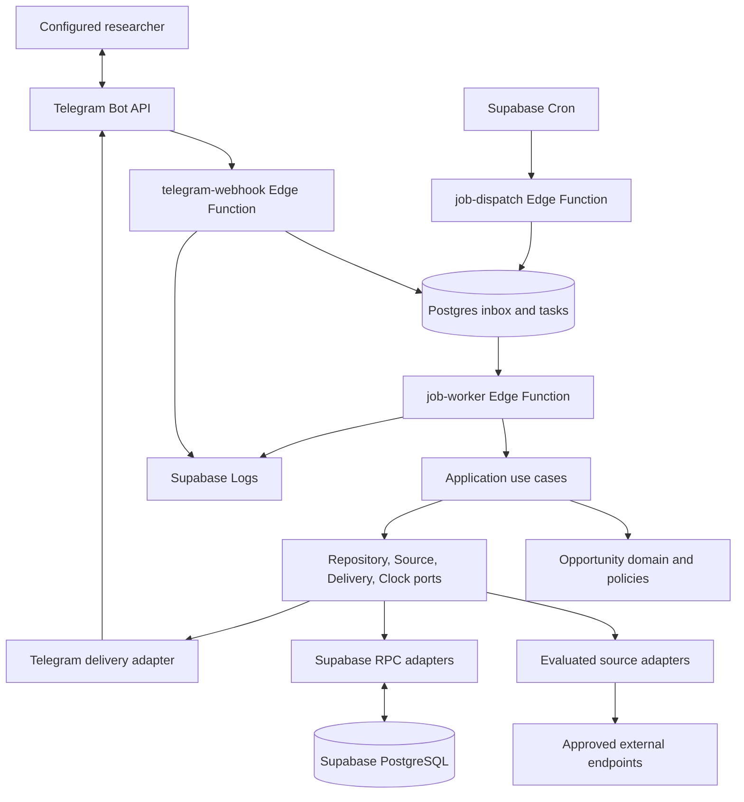

# Architecture

## System context and decisions

Research Radar is a single-researcher system with shared opportunity data and profile-scoped personalization. Supabase is the only backend platform. TypeScript runs in Deno-compatible Edge Functions. PostgreSQL holds durable application state; `supabase-js` calls narrow RPCs. Telegram and external sources are adapters. No persistent worker process or local production-equivalent database is part of the design.

Accepted decisions are in [docs/adr/](docs/adr/). [DATABASE.md](DATABASE.md) defines persistence contracts; [PRODUCT_SPEC.md](PRODUCT_SPEC.md) defines behavior. Persistence and the source-neutral pipeline have isolated hosted verification. Reviewed conference, position and funding adapters exist; Phase 06 adds journal calls. The Telegram adapter now exists locally; recurring scheduling and production deployment remain later-phase work. Current execution status is solely in [PLANS.md](PLANS.md).

## High-level architecture



The three function names are intended entrypoints. `telegram-webhook` validates and durably records updates; it may immediately process a small claimed command task for low latency. `job-dispatch` creates due work without performing full collections. `job-worker` claims bounded tasks. Cron provides recovery even if an immediate best-effort kick or an Edge worker disappears. No correctness depends on detached promises or `waitUntil` completing.

## Data flow and pipeline

1. **Collection:** an adapter fetches one bounded page using an injected HTTP client, timeout, cursor, and conditional validators.
2. **Parsing:** its pure parser extracts source-neutral drafts or individual record errors. Transport failures and document-wide parse failures differ from bad sibling records.
3. **Normalization:** shared rules normalize Unicode, safe URLs, types, organizations, topics, countries, and temporal representations. Source adapters explain source conventions; generic normalization does not know source field names.
4. **Validation:** require title, supported type, provenance, and safe original URL. Quarantine unusable records; incomplete but useful records may pass with quality flags and null fields.
5. **Deduplication:** resolve source identity and conservative strong identities; use fingerprints to find deterministic candidates, not as an unconditional global unique key.
6. **Persistence:** an atomic RPC writes source record, canonical opportunity, deadlines, identity claims, revisions, and page accounting. Commit a cursor only after every page record has a durable accepted/rejected disposition.
7. **Deterministic filtering:** enforce profile exclusions and lifecycle/feedback gates. Persist decisions against the opportunity and profile revision.
8. **Ranking:** compute explainable scores and stable ordering. Optional future LLM scoring receives only the bounded eligible shortlist.
9. **Notification:** freeze a due digest/reminder payload and its item claims in a transaction, then send its persisted message parts through a delivery port.
10. **Scheduling:** Cron ticks create unique due tasks and workers claim them with leases. Scheduled work and `/refresh` use the same use cases.
11. **Feedback:** authorized Save/Ignore/Open intent writes an idempotent event and current profile-opportunity state; later assessment and reminder eligibility use that state.

Collection completion is not required for browsing or digest generation. A digest uses the latest available data and includes a compact stale-source warning when appropriate. Ranking is refreshed for changed records and profile revisions; sending rechecks exclusions, lifecycle, ignore state, and relevant deadline revision.

## Module boundaries and dependency direction

Planned layout, created only when its owning phase needs it:

```text
deno.json / deno.lock                    # tasks, pinned dependencies, formatter, compiler
supabase/config.toml                    # project and per-function auth configuration
supabase/migrations/                    # append-only release history
supabase/tests/database/                # hosted disposable-schema assertions
supabase/functions/
  telegram-webhook/index.ts              # HTTP composition root, phase 07
  job-dispatch/index.ts                  # internal tick endpoint, phase 09
  job-worker/index.ts                    # task dispatcher, phase 03 then extended
  _shared/
    domain/                             # models, normalization, identity and score policies
    application/                        # use cases and typed ports
    adapters/sources/<source-slug>/      # fetch, parse, mapping, source manifest
    adapters/telegram/                  # Telegram DTOs, routing, callbacks, rendering, send
    infrastructure/supabase/            # RPC clients, persistence DTO mapping
    infrastructure/http/               # timeouts, approved destinations, bounded responses
    infrastructure/observability/      # structured redacted logging
tests/unit/                             # pure domain/use-case tests
tests/contract/                         # source contract and adapter parity tests
tests/fixtures/<source-slug>/           # sanitized data, expected output, provenance
tests/integration/                      # hosted database workflows and fake HTTP boundaries
scripts/                                # checks and future explicit deployment tools
```

`domain` imports only domain modules and standard language facilities. It cannot import Deno environment APIs, `supabase-js`, Telegram DTOs, HTTP clients, source identifiers as branches, or an LLM SDK. `application` imports domain and declares ports. Adapters and infrastructure implement those ports and may import inward. Entrypoints wire concrete dependencies. No adapter imports another adapter to perform business logic. Database row types remain inside persistence mapping.

Shared application ports include `OpportunityRepository`, `SourceRepository`, `WorkRepository`, `ProfileRepository`, `AssessmentRepository`, `NotificationRepository`, `FeedbackRepository`, `SourceAdapter`, `DeliveryPort`, `Clock`, `HttpClient`, and future `ShortlistReranker`. Keep ports small by use case; do not implement a general framework or expose arbitrary SQL through them.

## Source adapter architecture

Every source has a versioned manifest: stable slug, supported types, approved fetch hosts/paths, cadence, per-host request rate, response/record bounds, terms/robots review, parser version, and fixture references. Runtime state and cursors live in PostgreSQL, not the manifest.

The conceptual `SourceAdapter` contract is:

```text
slug, parserVersion, supportedTypes
collectPage(context, cursor, conditionalValidators) -> CollectedPage
parsePage(CollectedPage) -> iterable of ParsedRecord | RecordError

context = injected HTTP client, clock, abort signal, limits, source configuration
CollectedPage = bounded payload, format, fetchedAt, sourceRevision?, nextCursor?, validators?, notModified
ParsedRecord = stable sourceRecordKey, sourceUrl, OpportunityDraft, bounded source metadata
RecordError = stable record key if derivable, reason code, sanitized evidence
```

Parsing and mapping are pure; HTTP happens only in collection. Drafts use shared field names and temporal evidence, not Telegram strings or database rows. Stable keys cannot contain a mutable deadline. If a source lacks IDs, derive a documented URL/cycle/track key; a completely malformed item can use a page/revision/index key for rejection accounting only. That fallback is never a canonical opportunity identity.

One collection task handles at most one page. Initial safety budgets: 15-second HTTP timeout, two concurrent requests maximum per worker (one per host unless permitted), 2 MiB decompressed payload per request, 100 drafts per page or bounded chunks of a dataset. A single monolithic dataset must be measured; it cannot be called paginated just because processing is chunked. Prefer individual bounded files or a conditional snapshot with capped scope. Phase 04 must benchmark YAML parsing and revise the adapter strategy if the hosted CPU budget fails.

A first source is not a source framework template for every website. Format libraries must be Deno-compatible and pinned; XML external entities and unbounded YAML aliases must be disabled. Browser-required sources are deferred or rejected because the intended runtime does not include a browser.

Phase 05 adds narrowly allowlisted read-only JSON POST to the existing HTTP port for documented funding APIs ([ADR 0011](docs/adr/0011-bounded-read-only-json-post.md)). POST is denied by default; exact approved endpoint/method configuration is trusted composition. Bodies are bounded JSON objects (4 KiB); GET/HEAD cannot carry bodies. Existing destination/redirect/response/timeout/header/concurrency protections remain. SourceAdapter/domain/persistence contracts are unchanged.

## Opportunity domain model

An Opportunity is a specific actionable listing, event edition/track, call, or funding scheme/cycle, independent of its discovery source and recipient. Its core fields are UUID, type code, title, organization display/normalized key, plain-text description, topic and qualification tags, countries/location, work mode (`onsite`, `hybrid`, `remote`, `unknown`), optional canonical URL, optional publication time, edition/cycle and track keys, optional parent ID, optional event dates, lifecycle status, quality flags, content revision, first/last seen and created/updated timestamps. Type-specific evidence belongs in a versioned attributes object, with validated shapes per type.

Each source observation owns source ID, source record key, original URL, fetched time, source revision, and bounded metadata. Each deadline owns its kind, round, date/instant/zone, certainty, and revision. Each profile assessment owns its score, reasons, exclusion result, and algorithm version. Each user-item state owns saved/ignored flags. Each delivery owns its sent time. These are deliberately not mutable columns on shared opportunities.

Organization aliases initially use a small versioned rule map, not an institution ontology. Topic tags are arrays, not a full taxonomy service. Recurring editions must be distinguishable. Different grant rounds or journal calls sharing a homepage cannot merge solely on that URL.

### Temporal policy

Use UTC instants only when the source gives a resolvable time and IANA zone or explicit offset. Preserve the original timezone token and whether it was explicit or a source default. `AoE` means UTC-12 only when the source convention supports that interpretation. Ambiguous abbreviations are flagged until an adapter-specific documented mapping resolves them. For local timestamps around DST transitions, require a deterministic supported policy or quarantine that deadline.

A date without time/zone stays a calendar date; it is not silently set to 23:59 UTC. Unknown/TBD/rolling deadlines have null date/instant and explicit labels. Date-only reminders are advisories, not countdowns. Event dates do not become application deadlines. Multiple abstract/submission rounds stay in `opportunity_deadlines`; changing a deadline increments its revision without changing opportunity identity. Exact deadlines expire by instant. Date-only unknown-zone listings are conservatively expired only after that calendar day has ended at UTC-12, while displaying the original uncertainty. A rolling item requires explicit source status or a freshness policy, not an invented expiry.

## Database responsibilities

PostgreSQL owns foreign keys, unique identities, transaction boundaries, versions, current feedback state, inbox/outbox, task claims, and scheduling keys. It does not fetch websites, parse HTML, score using external APIs, or call Telegram inside an opportunity transaction. Keep all application tables in private `radar`; expose only reviewed `public.rr_*` RPCs callable by the backend role. SQL functions default to `SECURITY INVOKER`; exceptions require review and a fixed empty search path with qualified references.

Phase 02 authors these tables and twelve persistence RPCs, with exact contexts and cursor serialization in DATABASE.md and [ADR 0007](docs/adr/0007-database-primitives-and-hosted-verification.md). Short canonical/assessment writes share a transaction advisory lock; external collection remains independent. The [remote-first verification workflow](docs/DATABASE_WORKFLOW.md) uses a tooling-only direct SQL client, not an application adapter. Hosted SQL/type/security/concurrency verification and actual generated types remain pending until an isolated target is supplied.

Transactions are required for source-record upsert/deduplication, page commit and continuation, feedback/state update, webhook receipt/task enqueue, task claim/complete, and notification preparation/item claims. Avoid a sequence of independent REST writes that can lose state between requests. DATABASE.md specifies keys and fencing.

## Deduplication and reconciliation

1. Match `(source_id, source_record_key)`. Re-fetching updates that observation and its canonical target.
2. Normalize URLs: lowercase scheme/host, remove fragments/default ports/approved tracking parameters, preserve identity-bearing queries and case-sensitive paths. Treat HTTP/HTTPS or redirect aliases as equivalent only under a reviewed host rule; never follow arbitrary discovered URLs merely to compare them.
3. Claim globally unique strong identities only for qualified listing URLs or trusted natural keys that include type family, edition/cycle, and track. A homepage reused yearly is a candidate key, never sufficient evidence.
4. Compute a versioned candidate fingerprint from type family, normalized title/organization, cycle/edition, and track. Keep it indexed but nonunique. Deadline is comparison evidence, excluded from stable identity because it changes.
5. Auto-merge a fingerprint candidate only when required identity fields are known and agree with no cycle/track/organization conflict. Similar titles, close deadlines, or missing years alone are insufficient. Unknown organization can still merge through a proven listing identity, not through a weak fingerprint.
6. Ambiguous cases remain separate and get a quality flag with candidate IDs. Future fuzzy/semantic matching can propose a review, but cannot silently merge. No embedding or LLM service is required.

Identity claims and canonical creation run atomically. Concurrent conflicts re-read the winning claim and attach the observation; transaction rollback leaves no orphan canonical row. If two strong keys point to different existing canonicals, quarantine the conflict for operator resolution rather than pick a winner. Manual merges preserve old IDs as redirects, remap feedback/notification references in a reviewed transaction, and retain evidence; automated merge tooling is deferred beyond Phase 10 unless a real conflict requires it.

Reconciliation chooses fields by configured source authority for that field/type, then freshness and deterministic source-slug tie break. An official page can outrank an aggregator; such precedence is reviewed, not assumed by domain code. Nulls never erase stronger non-null evidence. Conflicting deadlines are flagged and precise reminders paused until resolved. Missing from one partial feed does not imply withdrawn. Source loss alone marks stale. For positions/funding/standalone calls, explicit closure or all known actionable deadlines elapsed with no unknown/rolling round can close the item. For conferences/workshops, elapsed submission deadlines close those submission rounds, not the upcoming event; event closure follows explicit cancellation/closure or the known event end (start date if no end), with conservative calendar-date handling. Browsing shows both event lifecycle and submission availability. Do not infer an event application deadline from its start date.

## Ranking architecture

Deterministic filtering returns eligibility and reason codes before scoring. Exclude unsupported/disabled types, explicit ignore, withdrawn/expired records, blocked topics/institutions, configured hard geography, and proven qualification/eligibility conflicts. Unknown data is not disqualifying unless the profile explicitly says so. Saved/ignored precedence is deterministic: ignore suppresses delivery even if saved.

Explicit profile `ignored_topics` act as exclusion phrases with an `ignored_topic` reason, like a user-maintained negative list. They are not automatically inferred from per-item Ignore feedback; no profile-learning behavior is implemented. Event lifecycle and submission availability are separate derived facts, so a conference can remain browsable after its paper deadline.

Proposed rule version `deterministic-v1`, calibrated in Phase 08:

| Component | Points | Rule |
| --- | --- | --- |
| Topic match | 0-40 | Weighted positive topic phrases; matched weight / configured positive weight, capped at 1. Unicode-aware phrase boundaries, explicit aliases, no arbitrary substring matching. |
| Type preference | 0-15 | Per-type profile weight in [0,1]. |
| Country/work mode preference | 0-10 | Configured preference; unknown contributes 0 and a warning, not an invented match. |
| Institution preference | 0-10 | Explicit configured normalized organization match. |
| Deadline usefulness | 0-10 | 3-30 days: 10; 31-90: 6; 0-2: 3; later/unknown/rolling: 0. Date-only uses calendar dates with a reason flag. |
| Freshness | 0-10 | First seen <=7 days: 10; <=30: 5; otherwise 0. Re-fetch does not reset freshness. |
| Qualification match | 0-5 | Explicit compatible structured evidence; unknown: 0. |

Total 0-100; provisional uncalibrated digest threshold 40, shortlist at most 50, digest at most ten. Positive topics are required for automatic delivery; browse can still show unscored records before setup. Stable ordering is score descending, next actionable deadline ascending with nulls last, first-seen descending, UUID ascending. Each assessment stores components, matched terms, exclusions, data-quality flags, opportunity revision, profile revision, rule version, evaluated time, and next expiry/re-evaluation time. Scores are not probabilities.

The application decides whether an assessment is fresh; changed opportunity/profile/rules invalidate it. Time-sensitive components are recomputed at least daily and at notification preparation. An optional future `ShortlistReranker` accepts <=50 eligible summaries with a fixed timeout, version, budget, and structured explanation schema. Failure falls back to deterministic order; it cannot resurrect exclusions or mutate canonical facts. Provider selection, costs, and evaluations are deferred beyond Phase 10.

## Telegram responsibilities

Phase 07 concretizes this boundary in `_shared/adapters/telegram/`, transport-neutral `application/interaction.ts`, Supabase interaction mapping and a thin `telegram-webhook` root. [ADR 0012](docs/adr/0012-durable-telegram-interactions.md) specifies text-ID ingress, inbox effect journaling, atomic reply preparation/completion, stable 100-ID/three-slot snapshot pages, message-bound opaque callbacks, ordered parts and binding revalidation. The existing notification tables carry command replies; no second outbox/token table or ingestion path is added. [Runbook](docs/TELEGRAM.md) records limits/configuration and the production prohibition.

The Telegram adapter owns Bot API payloads, command routing, escaped rendering, pagination tokens, callbacks, user/chat extraction, and transport errors. Application handlers receive authorized `profileId`, action, and domain IDs. The domain never receives a Telegram Update, keyboard, or chat ID.

Webhook lifecycle: create a real bot in Phase 10, configure an HTTPS webhook with secret header and only needed update types, inspect `getWebhookInfo`, test live delivery, monitor backlog, and explicitly manage rotation/removal. Phase 07 uses mocks and an optional separate test bot. See [DEPLOYMENT.md](DEPLOYMENT.md).

Verify the header `X-Telegram-Bot-Api-Secret-Token` before parsing accepted work; bound body size (initially 64 KiB), accept POST only, then authorize sender ID against the configured allowlist and require private chat and matching binding. Username is never identity. Callback queries use their actual sender and stored message destination, not untrusted callback IDs to select a profile. Treat Telegram numeric identifiers as lossless strings at TypeScript boundaries and `bigint`/text in storage.

Persist `(bot_id, update_id)` and a minimal normalized action with an enqueue in one transaction. Duplicate completed/accepted updates return 2xx without repeating effects; out-of-order IDs remain valid. Never discard all IDs below a high-water mark. On database failure return 5xx so Telegram can retry; invalid secret returns 401/403; valid but unauthorized/unsupported messages get 2xx with no privileged effect. Valid malformed payloads receive a recorded rejection where possible, without a retry storm.

Command work is bounded. Queries return paginated snapshots; `/refresh` only enqueues collection. Callback payloads fit Telegram's byte limit and use versioned action codes plus opaque IDs; authorize every action, expire pagination, and recheck entity existence. Long explanations are details pages. A direct URL button cannot produce Open telemetry. A tracked Open callback records intent and provides the original safe URL; do not claim a confirmed browser visit. Acknowledge callback queries promptly with bounded best effort; business actions and replies use persisted work.

## Cron responsibilities and durable work

Phase 09 registers named dispatch and worker ticks using Supabase Cron/`pg_net`. Job definitions use UTC; due-local dates and times come from each profile's IANA timezone. Track the local schedule key and timezone revision, handle DST gaps by the next valid local instant and folds by one local-date key. Changing timezone or send time affects future unprepared dates only, and cannot create a second digest for a local date already prepared.

Collection cadence, assessment refresh, digest/reminder preparation, outbox sending, and retention are separate task kinds, with a small fixed dispatcher. Do not add a general workflow engine. `job_tasks` stores bounded payloads, unique request keys, `available_at`, attempts, leases, and terminal outcomes. `FOR UPDATE SKIP LOCKED` atomically claims tasks. One worker invocation handles a bounded batch (initially <=5 tasks and <=45 seconds total); a page task may yield a continuation. The actual plan/CPU limits take precedence over these targets.

Collection schedule requests use source ID plus its due-time slot; manual requests use the accepted action ID, while an active per-source coalescing key prevents simultaneous runs from either trigger. Page tasks use `collect:<run-id>:<page-sequence>`. The run's committed sequence and expected cursor hash are compared atomically, so replay cannot re-add page counts. Maximum pages/run and snapshot-revision behavior are declared per source; repeated/nonadvancing cursors fail visibly rather than loop.

At terminal run completion, update source health and advance `next_due_at` once to completion time plus cadence (or later cooldown), including after a manual refresh. Safe task retries stay within the same run. After an outage, collect the latest state once rather than enqueue every missed historical interval. A canceled/disabled source never schedules a replacement until enabled.

Use a unique active-task coalescing key for collection per source. Cursor, run accounting, continuation enqueue, and current task completion commit atomically with the current fencing token. Continuations reuse the coalescing key only after the previous task is terminal within that transaction. Repeated ticks or `/refresh` while a source is active return the existing run. `collection_runs` also enforces at most one active run per source. Expired tasks resume the same run/cursor before new work is created.

Claims have a monotonically increasing lease generation. Every mutating task RPC compares task ID, generation, owner, and unexpired lease. Late workers cannot overwrite progress after reclamation. Initial lease 90 seconds with bounded renewal before an external operation; no lease spans a long sleep. Safe work retries at most three total claims with exponential backoff and jitter, then fails visibly. Honor server Retry-After, cap delay to the work's expiry window, and do not retry persistent authentication/parse/validation failures automatically. Network retries share this attempt budget rather than multiply it.

## Notification delivery and its limits

Notification preparation freezes deterministic content, ordered item claims, destination binding, local schedule key, and rendered message parts. Repeated preparation returns the same notification. Digest membership excludes items already claimed for that profile's first digest; reminders use `(profile, deadline ID, revision, offset)` regardless of source count. Query replies are keyed by inbox action, not digest membership.

Each part has a `notification_attempts` history. Record `sending` and the lease generation before calling Telegram. On a definite successful response, record Telegram message ID and `sent`. A definite failure that guarantees no accepted message can be retried within budget. Timeout, connection loss after request dispatch, unclassifiable server error, or crash after marking `sending` creates `uncertain`. Lease expiry never blindly resends a `sending` part. A crashed sender cannot be fenced at Telegram itself; do not launch a replacement sender while it could still complete. See OPERATIONS.md for the conservative resolution window.

Reminder preparation uses the profile's digest local time on the deadline's profile-local date minus its offset; date-only evidence instead uses the published calendar date and an advisory label. Do not backfill an offset after its six-hour window. Schedule uniqueness is profile/kind/key, independent of a replacement delivery target. Freeze the target at preparation and cancel/reprepare only definitely unsent work when rebinding.

This is durable duplicate prevention and explicit ambiguity management, not exactly-once delivery. Telegram does not offer an application idempotency key for `sendMessage`. An operator may mark an uncertain part delivered after inspection, abandon it, or authorize a documented resend with duplicate risk. Before claiming a part for sending, recheck its items; if any became ineligible, cancel that definitely unsent part and release only its claims transactionally. Remaining eligible items may enter a later day's digest within the normal window. An entirely unsent digest can instead be rebuilt under the same schedule key. Sent or uncertain parts are immutable and retain claims. Partially sent digests retain their schedule key and report partial status. An Ignore/profile change after the sending claim may not prevent the already in-flight message; its effect applies to subsequent claims.

## Failure isolation and observability

Each source has separate runs, timeout budget, retry budget, and cooldown. A bad record is quarantined individually. A document-wide parse change fails that source; it cannot be a successful zero-record run. Empty-but-valid and HTTP not-modified runs are distinct. Unexpected sharp yield drops (initially >80% versus last successful comparable full run) warn and pause automatic withdrawal inference. Disable/cool down a source after three failed runs; manual disable always wins. Healthy sources continue.

Structured logs contain event name, request/task/run/source/profile IDs where needed, stage, duration, counts, lease generation, version, and redacted error code. Never log tokens, credential-bearing URLs, raw Telegram updates, source HTML, or full personal profile text. Persist collection counts, cursor/validator state, error samples, task outcomes, and notification attempts beyond log retention. Use database status queries and `/status`; the bot cannot alert through itself when Telegram is down, so the operator also checks Supabase monitoring. Phase 10 records whether any external alert integration is needed; it is not silently added.

## Security model

- **Ingress:** All three HTTPS functions are reachable at the gateway, with `verify_jwt=false` because they use explicit non-JWT authentication. The Telegram webhook handler requires the independent Telegram secret header and allowlist. Dispatcher/worker handlers require `X-Radar-Job-Secret`, containing the independent high-entropy `RADAR_INTERNAL_JOB_SECRET`, verified in constant-time before privileged work. Missing/unconfigured credentials fail closed. Internal endpoints are authenticated application surfaces; gateway reachability does not authorize a call. Never rely on a public publishable key.
- **Secrets:** Edge secrets contain bot token, webhook secret, internal job secret, and configured allowlist. Cron reads only its invocation secret and project URL from Supabase Vault. The job secret cannot query the database. Backend Supabase secret/service-role credentials stay inside functions and are never sent to Telegram, sources, or Cron requests. Supabase key behavior changes; Phase 02/10 must verify the actual project's supported key format rather than assume it is a JWT.
- **Database:** private schema, no `anon`/`authenticated` DML or RPC execution, RLS enabled on application tables with no public policies, restrictive defaults. Backend credentials bypass RLS and are privileged; RLS is not a defense against a compromised backend. Use reviewed RPCs and minimal grants, isolate operator/migration credentials, and never expose a generic RPC/SQL proxy.
- **Input:** bound HTTP payloads and parsing, sanitize text and URLs, block active markup in Telegram, parameterize SQL, validate profile/action schemas, and restrict fetch destinations to reviewed HTTPS hosts/paths. Reject userinfo, private/link-local IPs, and redirects outside the allowlist; protect against DNS rebinding using the supported HTTP strategy validated in Phase 03. If safe host resolution cannot be enforced in the runtime, restrict adapters to fixed endpoints without source-provided navigation and document the residual risk.
- **Least privilege:** delivery addresses are bound to the configured user, read queries are bounded, `/refresh` is throttled (initial target one accepted request per five minutes), and authenticated tasks cannot select arbitrary URLs or SQL. Supabase Auth onboarding is not needed for the initial Telegram-only user.

Supabase documents hosted [Edge limits](https://supabase.com/docs/guides/functions/limits), [scheduled function invocation and Vault](https://supabase.com/docs/guides/functions/schedule-functions), [function authentication](https://supabase.com/docs/guides/functions/auth-headers), and [RLS behavior](https://supabase.com/docs/guides/database/postgres/row-level-security). Telegram documents [webhook verification, retries, updates, and Bot API methods](https://core.telegram.org/bots/api). These references were reviewed on 2026-10-28; recheck them before implementation and release. Our specific budgets and state machines are project decisions, not platform guarantees.

## Phase 03 executable boundary

The implemented core is under `supabase/functions/_shared/`. `domain/model.ts` defines drafts, normalized facts, stable rounds, provenance and closed quality flags. `primitives.ts`, `temporal.ts`, `normalize.ts`, `identity.ts`, `reconcile.ts` and `assessment.ts` contain deterministic policies without provider imports, environment reads or IO. Display text uses NFC; comparison keys use NFKC/lowercase and collapsed whitespace. Organization aliases and numeric field/type authority are injected reviewed configuration, never inferred from a real source's name.

`application/ports.ts` defines the executable `SourceAdapter`: `slug`, `parserVersion`, `supportedTypes`, asynchronous `collectPage(context,cursor,validators)` and pure iterable `parsePage(page)`. `CollectedPage` carries bounded string payload/format, safe source URL, fetched instant, snapshot revision, next cursor and selected validators. Parsing yields shared `ParsedRecord` or keyed `RecordError`; changed document shape throws a document failure. Adapter-specific producer fields appear only in `adapters/sources/fake/adapter.ts` during this phase. Its in-memory transport exercises pagination/validators/failures without making public requests.

`application/collect.ts` processes one page, deduplicates source keys within it, normalizes/validates siblings independently, reads bounded candidates, proposes reconciliation and invokes the atomic page RPC. Snapshots include bounded unresolved deadline evidence, not an entire source document. A stale content revision permits one re-read/reconcile/commit retry without refetching. PostgreSQL owns final identities, revisions, quarantine and counters. Completed-page tombstones stop replay before transport. Cursor hashes are returned by PostgreSQL, never recreated by JavaScript.

Conditional validators are reusable only from the latest terminal run when its entire snapshot was durably processed and config/parser versions still match. A failed continuation or newer failure invalidates reuse; an older complete run cannot hide that interruption. A fully processed partial run with explicit record quarantines is reusable. Reconciliation additionally carries an opaque `evidenceVersion` token: provenance-only changes leave content_revision stable but invalidate proposals based on older field authority ([ADR 0010](docs/adr/0010-provenance-optimistic-token.md)). SQL checks that token before mutating an existing canonical with explicit provenance; stale evidence receives the same bounded PT409 retry as stale content.

Fingerprint version 1 hashes the explicit ordered array `['research-radar-identity',1,family,titleKey,organizationKey,cycleKey,trackKey]` using SHA-256 and canonical JSON with recursively sorted object keys. Mutable deadlines/fetched times are excluded. Reviewed listing identities separately include actual type, safe URL, cycle and track. Natural keys require known organization/cycle/track; explicit default track is the empty string, absent track is null. Similar titles or unknown organization alone cannot authorize merging. Candidate sets truncated beyond five matches stay ambiguous.

Reconciliation uses reviewed field authority, observed instant and lexical source-slug tie breaking; null/unknown evidence cannot erase known values. A same-source correction revises its stable round. Conflicting known values from equally authoritative different sources mark the deadline conflicted; stronger reviewed evidence may resolve it. Canonical field provenance retains the selected source, including `deadline:<kind>:<round>` keys. The deadline row's `source_record_id` records the observation responsible for that revision, including a reported conflict. No real-source authority ranking is configured here.

`infrastructure/supabase/repository.ts` maps actual generated persistence types at the boundary and uses only narrow RPCs. Three fenced context RPCs and an atomic collection-to-assessment handoff close gaps found during implementation ([ADR 0008](docs/adr/0008-pipeline-context-and-durable-assessment.md)). The 18 entities/private schema remain intact. Zero enabled profiles allows collection without assessment; one receives idempotent batches; multiple enabled profiles fail explicitly because multi-user runtime is outside scope. Intentional stale revisions now return PT409/HTTP 409 ([ADR 0009](docs/adr/0009-optimistic-conflict-http-status.md)); this avoids a verified platform retry problem without weakening rollback.

`application/worker.ts` claims only `collect_page` and `assess_batch`, handles at most five tasks/45 seconds, renews before collection and awaits all operations. SQL owns fencing and the three-claim ceiling. Backoff honors Retry-After with bounded deterministic jitter. Supabase-js retries are disabled; uncertain RPC outcomes rely on durable state/replay. `job-worker/index.ts` composes the core behind mandatory internal-secret verification before constructing a privileged client. Local `verify_jwt=false` selects this custom gate; no function is deployed or scheduled.

The HTTP port supports GET/HEAD, selected headers, timeout/abort, bounded response bytes and selected metadata; Phase 05 adds separately allowlisted read-only JSON POST ([ADR 0011](docs/adr/0011-bounded-read-only-json-post.md)). Implementation permits only exact reviewed HTTPS endpoints, rejects userinfo/IP/local hosts/non-web schemes and all redirects, and bounds concurrency to two globally/one per host with eight waiters. Normalization performs no network lookup; only known tracking parameters/fragments are removed, preserving identity queries/path case. **Residual DNS risk:** Deno fetch does not pin verified DNS addresses, so an approved hostname could resolve to a private address. Endpoint ownership remains a per-source/production review gate; user/source-supplied links cannot populate the allowlist.

Baseline `deterministic-v1` implements the documented exclusions/components and stores reasons/revisions. Date-only expiry derives end-of-day UTC-12 only for eligibility; it is never stored as a source deadline. Unknown/rolling/conflicted rounds prevent inferred closure. Publication-date-only evidence stays in attributes with null `published_at`. Phase 08 owns calibration/profile editing; no LLM SDK or reranker is implemented.

## Phase 04 concrete source boundary

The CCFDDL adapter uses two reviewed fixed raw-file endpoints (SIGMOD conference, HotOS workshop), with a pure strict YAML 1.2 parser and source-local temporal/round mapping. A second provider reads exactly one public OpenReview API 2 invitation for the separate ICLR workshop-organizer call. Its parser retains public metadata only. Permission, provenance, resource limits and current evidence are in [CCFDDL](docs/sources/ccfddl.md) and [OpenReview](docs/sources/openreview-calls.md) source decisions. No arbitrary official-page navigation or source-specific domain branches are introduced. The worker composes the reviewed registry; the fake adapter is test-only. Runtime registration does not deploy, enable database source rows or schedule collection.

A measured SIGMOD edition contains sixteen deadline entries and requires over 20,000 bytes after canonical facts, observation evidence and field provenance are combined. The shared application therefore bounds each complete proposal at 32 KiB and the aggregate proposals at 1 MiB before commit. This preserves the SQL 2 MiB page ceiling and all existing observation/canonical limits. Oversized aggregate work fails without advancing the cursor; it is not silently truncated. This corrects an overly restrictive Phase 03 implementation budget; the database and SourceAdapter contracts are unchanged.

## Phase 06 concrete journal boundary

The JEACS adapter reads exactly the reviewed announcements, journal policy and at most one fixed call detail (230), through the existing bounded HTTP port. The pure parse5 8.0.0 parser bounds input bytes/tokens/nodes/depth, ignores executable markup and extracts attributed factual projections. No arbitrary linked page is fetched. SourceAdapter, domain, repository RPCs and database schema are unchanged. [Source decision](docs/sources/jeacs-journals.md) records current access/license evidence, fixed limits and nonpersonal humanities test scope.

An explicitly unthemed regular-issue author call maps to `journal_cfp`; a thematic special issue including its author call maps once to `journal_special_issue`. Published collections, dissertation lists, editor proposals and unsupported ambiguous calls are excluded. Historical deadline-expired calls may update closed records but never become accepting opportunities. Unknown old calls without current acceptance evidence are quarantined. Upcoming windows use unknown coarse lifecycle plus explicit source state/window; they must not be treated as open by future delivery code.

Reviewed repeated-announcement aliases share the original call key. Journal namespace, canonical announcement ID and explicit publication year qualify cycle identity; optional issue number and mutable dates are facts, not keys. Directory and detail observations share reviewed listing identity. Conflicting known dates retain both bounded round evidence values; the existing generic conflict policy pauses precise use. Explicit field authority is configuration, not an assumed universal publisher ranking. Journal policy supplies fees only when explicit; contradictory call-level fee evidence quarantines the call rather than inventing a waiver or fee.

Phase 06 exposed and corrected one source-neutral reconciliation bug: intrinsic conflicting evidence normalizes to unknown precision and previously took the missing-value preservation branch. On an existing known round this could leave the old date usable. The branch now distinguishes explicit `conflicted` evidence: preserve the previous candidate date/provenance for inspection but mark the round conflicted when incoming authority is equal or stronger. Strictly stronger reviewed prior authority remains usable. Consistent later evidence resolves through the same existing authority/freshness policy. Regression and hosted tests cover this correction; no interface, schema or new ranking rule is introduced.

## Future extension points and explicit deferrals

Phase 08 extends the existing scorer as `deterministic-v2`, preserving all seven component maxima. [ADR 0013](docs/adr/0013-versioned-profile-reranking.md) and [profile/ranking contract](docs/RANKING.md) specify strict schema-1 preferences, explicit known eligibility/excluded-country evidence, Unicode matching, precise time validity, rule-pinned projections and bounded revision-scoped keyset reranking through existing assessment tasks. Profile edits enqueue work atomically; old evaluations cannot overwrite newer results, and historical claims/feedback remain intact. The future `ShortlistReranker` is an interface only. Threshold 40 remains provisional and personal calibration is open; no LLM or schedule is added.

| Deferred work | Why | Resolution |
| --- | --- | --- |
| Exact SQL DDL and RPC signatures | Resolved by immutable migrations, actual generated types and isolated hosted verification; see DATABASE.md. | Completed in Phase 02 |
| Concrete source approval, rate limits, rights, parser feasibility | Public availability is not proof of stable permitted ingestion. | Phases 04-06, rechecked in 10 |
| Researcher profile, timezone, eligibility and thresholds | Personal facts have not been supplied. | Basic setup in 07; personalization in 08; confirmed in 10 |
| Measured resource budgets and paid-plan need | Existing Supabase project and plan are unknown. | Baseline in 02; benchmark in 04; release gate in 10 |
| Provider-specific LLM ranking and semantic deduplication | Deterministic behavior must be useful first; adds cost and uncertain facts. | Beyond Phase 10 by a new authorized phase/ADR |
| Multi-user provisioning, direct browser API, other delivery channels | One user and Telegram are the current product. | Beyond Phase 10; profile keys already preserve data boundaries |
| Full provenance history, embeddings, institution/topic ontologies | Current snapshot plus run history is sufficient initially. | Add only from measured need through an ADR |
