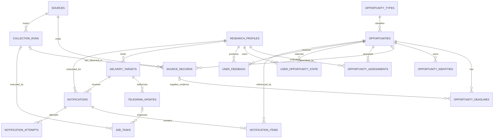

# Database design

## Status and ownership

Phase 07 adds three forward migrations, `20261030000100_telegram_interactions.sql`, `20261030000200_reply_order_and_binding.sql` and `20261030000300_projection_lifecycle.sql`, preserving all eighteen private tables and existing grants. Six backend invoker RPCs receive lossless text IDs, execute/journal one bounded interaction, browse authorized snapshots, atomically prepare a logical reply/complete its task, and begin/finish command-reply attempts. No direct table exposure, new table, broad grant or network IO is introduced. The corrections preserve ordered parts, original-account binding and explicit forecast/upcoming/submission-availability labels. See [ADR 0012](docs/adr/0012-durable-telegram-interactions.md) and [Telegram runbook](docs/TELEGRAM.md). Actual generated types come from hosted verification, never handwritten signatures.

The Phase 02 baseline applied three migrations on an isolated hosted development project and generated actual persistence types. Its historical evidence covers 70 SQL assertions, ten query-plan assertions, concurrency, privileges, no-op reapply and cleanup; subsequent phase evidence extends that baseline. Supabase PostgreSQL remains the durable store, with no required local database. See [verification evidence](docs/verification/phase02-database.md), [database workflow](docs/DATABASE_WORKFLOW.md) and [ADR 0007](docs/adr/0007-database-primitives-and-hosted-verification.md). No production migration occurred.

All application tables live in private schema `radar`, excluded from exposed Data API schemas. Backend-only `public.rr_*` RPCs provide a narrow API for `supabase-js`. Use UUID primary keys except stable type codes and natural settings keys. Timestamps are `timestamptz` in UTC; calendar dates remain `date`. Foreign keys default to restrict deletion for records with history. Do not cascade-delete opportunities, profiles, or sources during routine cleanup.

## Conceptual ER diagram

`job_tasks` also supports ranking, notification and maintenance tasks through validated kind-specific payloads. `system_settings` is a small key/value table and has no foreign-key hub role. No generic entity-attribute-value subsystem is planned.

## Core and source tables

### `opportunity_types`

`code text PK`, `label`, `family` (`position`, `event`, `call`, `funding`), `enabled`, `created_at`. Seed the eleven PRODUCT_SPEC.md codes, not one type per source. Family is a grouping aid, not a substitute for precise types. Add types through reviewed migrations; application parsers must explicitly support them.

### `opportunities`

| Column | Nullability / meaning |
| --- | --- |
| `id uuid` | Required PK; stable internal reference. |
| `type_code text` | Required FK to `opportunity_types`. |
| `title text`, `title_key text` | Required nonempty display text and versioned normalized comparison text. |
| `organization text`, `organization_key text` | Nullable when absent; not the source publisher unless it is actually the hiring/hosting/funding body. |
| `description text` | Nullable bounded plain text; no arbitrary executable HTML. |
| `topics text[]`, `qualification_tags text[]` | Required arrays, empty when unknown; normalized tags. |
| `country_codes text[]`, `location_text text` | Empty countries/nullable display location when unknown; multiple countries supported. Use validated ISO codes, not a country table initially. |
| `work_mode text` | Required `onsite`, `hybrid`, `remote`, `unknown`; avoids treating missing remote data as false. |
| `canonical_url text` | Nullable safe best official URL; nonunique because homepages can be reused. Original observation URL is required elsewhere. |
| `published_at timestamptz` | Nullable; never replace with fetch time. Source date-only publication evidence stays in attributes. |
| `cycle_key text`, `track_key text` | Nullable when truly unknown; normalized year/edition/round identity as applicable. Empty track means a documented main track, not an unknown distinct track. |
| `parent_opportunity_id uuid` | Nullable self FK for separate child calls/tracks; no self-parent; application prevents cycles. |
| `event_start date`, `event_end date` | Nullable event dates, check end >= start when both exist. |
| `status text` | Required `open`, `closed`, `withdrawn`, `unknown`, `merged`; status is shared lifecycle, never a user's saved state. |
| `merged_into_id uuid` | Nullable self FK; required only for reviewed `merged` records; never merge into self or create redirect cycles. |
| `fingerprint text`, `fingerprint_version int` | Required nonunique candidate fingerprint and algorithm version. |
| `attributes jsonb` | Required object with `schema_version` and validated type-specific evidence. |
| `quality_flags text[]`, `field_provenance jsonb` | Required array/object; provenance maps canonical fields to source record IDs and selected evidence versions, not whole documents. |
| `content_revision bigint` | Required, starts at 1; increments on meaningfully changed canonical fields/deadlines, not every fetch. |
| `first_seen_at`, `last_seen_at`, `created_at`, `updated_at` | Required; first seen is immutable and drives freshness. Updated time is not an identity. |

Checks cover allowed lifecycle/work mode, nonempty bounded title, positive revision, URL shape and attribute object shape. Full URL and type-shape validation also happens at the application boundary. Store a deterministic canonical content hash so equivalent upserts do not increment revision or trigger unnecessary re-ranking.

Do not add `source`, `source_id`, `source_url`, `fetched_at`, `deadline`, `score`, `score_reason`, `notified_at`, `saved`, or `ignored` as single shared columns. Their many-to-one/profile/channel semantics require the tables below. A read DTO may project a primary source, next deadline, current assessment and user state for Telegram.

Phase 06 journal projections use existing columns only. `attributes.journal` contains bounded name/publisher/ISSN/journal URL (2 KiB domain limit). `attributes.journal_call` version 1 contains canonical announcement ID, theme, explicit edition/year, source lifecycle, opening temporal evidence, bounded scope/editors/topics/restrictions and informational fees with amount/currency/conditions/evidence URL. Root attributes remain bounded at 8 KiB; observations at 12 KiB and metadata at 2 KiB. Calendar publication evidence remains `attributes.publication_date` with null `published_at`, never a manufactured instant.

Source-record metadata traces directory/detail/policy roles, announcement aliases and fetched revision; `normalized_snapshot.deadline_evidence` retains bounded conflicting round values. Canonical field provenance remains bound to real source-record IDs through the existing RPC. Journal facts, user scores and delivery state are not mixed. No new table, migration, grant, enum, RPC or generated type is needed for this source family.

### `opportunity_deadlines`

`id uuid PK`, `opportunity_id FK`, `kind` (`application`, `abstract`, `submission`, `registration`, `rebuttal`, `decision`, `other`), `round_key text`, `label`, `due_at timestamptz?`, `due_date date?`, `timezone text?`, `raw_value text?`, `precision` (`instant`, `date`, `unknown`), `basis` (`explicit`, `source_default`, `unknown`), `status` (`current`, `superseded`, `conflicted`), `revision int`, `source_record_id FK?`, `created_at`, `updated_at`.

Unique `(opportunity_id, kind, round_key)`; maintain one row per logical deadline, increment its revision when its time/precision/status changes. Round keys are stable source round IDs or documented semantic keys; mutable deadline text cannot be the key. When a source has no round ID, the adapter must preserve stable matching or flag ambiguity rather than renumber all rounds on array insertion. Superseded deadlines retain IDs. Old deadline facts required for a sent reminder remain in its immutable notification snapshot; full deadline revision history is deferred.

Precision checks: `instant` requires `due_at`, a timezone/explicit offset, and non-unknown basis; `date` requires `due_date` and null `due_at`; `unknown` has both null and a label such as TBD or rolling. Instant rows can retain a local `due_date` for display. Timezone tokens are validated by shared conversion rules. Conflicted rows are excluded from precise reminders. Due times cannot be invented from fetch or event time. A reminder's eligibility uses its kind: application/abstract/submission/registration by default, never decision/rebuttal without explicit profile choice.

### `opportunity_identities`

`id`, `opportunity_id FK`, `kind`, `key_version`, `value text`, `source_record_id FK?`, `evidence jsonb`, `created_at`; globally unique `(kind, key_version, value)` for strong identity claims only. Examples: a listing-specific normalized URL qualified by cycle/track, or a reviewed natural key including type family, normalized organization, title, cycle, and track. Indexed values/source-record keys are bounded to 2,000 UTF-8 bytes; longer identity inputs use a versioned strong digest with normalized components in `evidence` (at most 8 KiB). This concretizes the existing evidence requirement without moving core facts into JSONB.

Candidate fingerprints belong on `opportunities` and are not unique here. Hashes use a versioned canonical serialization and a strong hash; store normalized components in bounded evidence to diagnose a collision. Changing normalization versions requires an explicit backfill/conflict audit, never silently creating a second identity namespace that loses existing matches.

### `sources`

`id`, `slug UNIQUE`, `name`, `category`, `adapter_version`, `enabled`, `approved_at?`, `config_version`, `config jsonb`, `cadence_minutes`, `next_due_at`, `last_success_at?`, `consecutive_failures`, `cooldown_until?`, `health_status`, `created_at`, `updated_at`.

Config contains approved endpoints, limits, and non-secret source options. No free-form user-supplied URLs or API tokens. Code manifests define supported adapters; a database row cannot load arbitrary code. Health is derived from run outcomes; counters are updated transactionally. Distinguish manually disabled from temporary cooldown. `approved_at` is set only after source rights/access review. One source per independently failing endpoint/configuration unit, not one row per individual job listing.

### `source_records`

`id`, `source_id FK`, `source_record_key text`, `opportunity_id FK?`, `source_url text`, `source_revision?`, `parser_version`, `payload_hash`, `record_status` (`accepted`, `quarantined`, `conflict`), `normalized_snapshot jsonb?`, `metadata jsonb`, `error_code?`, `quality_flags text[]`, `first_seen_at`, `last_seen_at`, `last_run_id FK?`.

Unique `(source_id, source_record_key)`. Accepted rows require an opportunity FK; quarantined/conflicting rows can have no canonical target. Original source URL is required and safe; source metadata distinguishes official target URL from aggregator listing URL. Store the latest bounded sanitized snapshot (initial target <=16 KiB combined JSON per record), not a full HTML archive. Keep enough evidence to diagnose/re-normalize; if evidence was truncated, replay requires a controlled source re-fetch or fixture. Last-seen is observation time, not proof that a rolling listing is still accepting applications.

One opportunity can have many source records. One parsed logical record points at one opportunity; an adapter that expands a source listing into separate tracks derives stable child record keys. This table combines provenance mapping and current source-record state to avoid a premature extra join table. Full observation history is intentionally deferred; collection runs preserve historical outcomes and counts.

### `collection_runs`

`id`, `source_id FK`, `trigger_kind` (`scheduled`, `manual`, `retry`, `test`), `request_key UNIQUE`, `status` (`queued`, `running`, `partial`, `succeeded`, `failed`, `canceled`), `started_at?`, `finished_at?`, `heartbeat_at?`, `cursor jsonb?`, `cursor_hash text`, `page_sequence bigint`, `source_revision?`, `conditional_validators jsonb`, `pages_committed`, `records_seen`, `accepted`, `inserted`, `updated`, `duplicates`, `rejected`, `error_counts jsonb`, `error_samples jsonb`, `adapter_version`, `config_version`, `duration_ms?`.

Partial unique index on `source_id` where status is queued/running. `partial` is terminal with committed valid data plus documented rejected/incomplete work. Safe transient retries resume the same active run/cursor until attempts exhaust; a terminal partial/failed run needs a new explicit run request. A page task is uniquely keyed `collect:<run-id>:<page-sequence>`. Its commit RPC compares the expected sequence and cursor hash plus the fenced lease, then increments the committed sequence, updates the cursor and counters, completes the task and enqueues the next sequence atomically. Replaying a completed task returns its existing terminal disposition without re-adding counts. No unbounded committed-page ledger is needed. Phase 02 fixes serialization/hash details and verifies this compare-and-swap behavior. Nonadvancing cursors, per-run page caps and snapshot revision changes are explicit adapter/run errors, not infinite continuations.

Counters have defined semantics: `records_seen = accepted + rejected`; accepted counts source records successfully resolved, with canonical outcomes partitioned into inserted/updated/duplicates. If an unchanged source record is seen twice within a page, count it once by source record key. Document-wide fetch/parse failure records an error without pretending there were zero valid records. Error samples are capped (initially 20, sanitized and length-limited); aggregate error counts retain totals. A 304 counts as a successful unchanged check and updates source freshness without inventing record fetches.

Finalizing a run updates source health and advances `next_due_at` exactly once to completion plus cadence, or later cooldown, including manual refresh runs. Retries retain the active run and cursor. Disabled/canceled sources do not dispatch replacements. After downtime, one due collection fetches current state instead of replaying every missed interval.

## Profile, feedback, and delivery tables

### `research_profiles`

`id`, `display_name`, `enabled`, `timezone text`, `digest_local_time time`, `digest_enabled`, `reminders_enabled`, `revision bigint`, `rules_schema_version int`, `rules jsonb`, `created_at`, `updated_at`.

Rules contain positive/blocked/ignored topics, type weights, institution and geography preferences, qualification/eligibility facts, unknown-data policy, thresholds, and reminder offsets. Common schedule fields remain typed columns for due queries. Enforce a valid IANA timezone and schema validation before enabling automatic delivery. Initial installation creates one disabled/incomplete profile or explicitly supplied operator profile, never fake research interests. The runtime initially enforces one enabled profile; no sign-up system or forced one-row database schema is needed.

### `opportunity_assessments`

`profile_id FK`, `opportunity_id FK`, `eligible bool`, `score numeric?`, `reason_codes text[]`, `components jsonb`, `opportunity_revision`, `profile_revision`, `rules_version`, `evaluated_at`, `valid_until`, optional future `reranker_version`/`reranker_result jsonb`.

PK `(profile_id, opportunity_id)` represents the current materialized assessment, not immutable history. Score is null for excluded items; otherwise 0-100. Store exclusion evidence even when not scored. Recompute when data/profile/rules change or time validity expires. Avoid schema columns tied to a particular LLM. A later assessment history table can be justified by actual evaluation needs.

### `user_opportunity_state`

`profile_id FK`, `opportunity_id FK`, `saved bool DEFAULT false`, `ignored bool DEFAULT false`, `saved_at?`, `ignored_at?`, `last_open_intent_at?`, `updated_at`; PK `(profile_id, opportunity_id)`. Ignore suppresses notification even when saved; keeping both flags allows undo without losing a save. These flags are current state, not shared opportunity lifecycle.

### `user_feedback`

`id`, `profile_id FK`, `opportunity_id FK`, `action` (`save`, `unsave`, `ignore`, `unignore`, `open_intent`), `idempotency_key text`, `occurred_at`, `context jsonb` (bounded view/assessment/rule version, no raw Telegram object). Unique `(profile_id, idempotency_key)` prevents duplicate webhook actions. Feedback append and current-state mutation share a transaction.

Later use can compare saves/ignores to topics, score components and presentation exposure; Open intent is weak evidence, not proof of interest or a page visit. Do not auto-update profile rules or train a model in the first release. Repeated intentional distinct actions remain distinct events, while replay of the same action is idempotent.

### `delivery_targets`

`id`, `profile_id FK`, `channel` (initially `telegram`), `external_account_id text`, `external_chat_id text`, `bot_id text`, `enabled`, `created_at`, `updated_at`. Unique `(channel, bot_id, external_account_id)` and one enabled Telegram target per profile/bot. Addresses are infrastructure data: Telegram adapter validates allowed private-chat user/chat pairing and converts IDs losslessly. No Telegram payload appears in domain types. A notification's profile must match its target, enforced by composite FK or the preparing RPC plus a database constraint.

### `telegram_updates`

Composite PK `(bot_id text, update_id bigint)`, `delivery_target_id FK`, `profile_id FK`, `action jsonb?`, `action_schema_version`, `payload_redacted_at?`, `status` (`accepted`, `processing`, `completed`, `rejected`, `failed`), `received_at`, `completed_at?`, `error_code?`. Nonterminal work requires an action; terminal action payloads may be nulled after retention with `payload_redacted_at`. Only authorized minimal normalized actions are stored; unauthorized requests produce a redacted count/log, not a raw user-data archive. Accepted unsupported actions can be recorded as rejected with no task. Command task payloads reference this inbox key rather than duplicate full message/profile text.

Receipt plus command task creation is atomic. Keep the unique ID tombstone after action payload cleanup so delayed replays cannot perform the action again. Do not use maximum update ID as an ordering or deduplication mechanism. The action schema belongs to the Telegram adapter; its translation to application commands is explicit.

### `notifications`

`id`, `profile_id FK`, `delivery_target_id FK`, `kind` (`digest`, `reminder`, `command_reply`), `schedule_key text`, `local_date date?`, `timezone_snapshot text?`, `due_at`, `expires_at`, `status` (`prepared`, `sending`, `sent`, `partial`, `uncertain`, `failed`, `skipped_empty`, `skipped_late`, `canceled`), `payload_version`, `parts jsonb`, `part_states jsonb`, `created_at`, `sent_at?`, `error_code?`.

Unique `(profile_id, kind, schedule_key)` for all kinds. Digest key is `digest:<local-date>`; local date is in the profile timezone frozen at preparation. Reminder key contains deadline ID, revision and offset. A command key contains bot/update/action, with bounded part numbering. Binding a new destination must not reset schedule uniqueness. Freeze the target at preparation; cancel/reprepare only definitely unsent work when rebinding. Never use a random UUID as the only retry key.

`parts` is an immutable array of bounded rendered transport-neutral message plans plus adapter rendering version, with ordered part IDs. `part_states` is a bounded (at most ten initial parts) state array updated only via checked RPCs. This avoids a separate message table for a one-user bot. If message volume grows, migrate to a parts table; do not let JSONB arrays grow unbounded. Secret tokens and full Telegram responses are excluded.

### `notification_items`

`id`, `notification_id FK`, `profile_id FK`, `opportunity_id FK`, `part_index`, `purpose` (`digest_first_seen`, `deadline_reminder`, `command_view`), `deadline_id FK?`, `deadline_revision?`, `reminder_offset_days?`, `claim_active bool`, `snapshot jsonb`, `created_at`.

Unique `(notification_id, opportunity_id, purpose, deadline identity where applicable)` implemented with explicit partial indexes/null handling. Active first-digest claim unique `(profile_id, opportunity_id)` where purpose is digest_first_seen and claim_active. Active reminder claim unique `(profile_id, deadline_id, deadline_revision, reminder_offset_days)` where purpose is deadline_reminder and claim_active. Reminder fields are required together. Command views do not claim notification eligibility. Prepare claims and notification in one transaction; a competing transaction must reselect its remaining candidates after conflict.

Claims remain active for sent/uncertain parts, including those in a partially delivered notification. A definitely unsent canceled part may release only its own claims transactionally; retain canceled history and original schedule accounting. Revalidate eligibility before a part's sending claim; if any item became ineligible, cancel that unsent part so no stale item is sent. Remaining eligible released items may appear on a later date within the normal window. Rebuilding the entire same-date notification reuses its logical key with a new prepared payload revision only if all parts were definitely unsent. Never release claims just because a send timed out. Profile/opportunity/deadline consistency is enforced at preparation and through composite constraints where practical.

### `notification_attempts`

`id`, `notification_id FK`, `part_index`, `attempt_number`, `task_id FK`, `lease_generation`, `state` (`sending`, `sent`, `retryable_failure`, `permanent_failure`, `uncertain`, `resolved_delivered`, `resolved_abandoned`), `started_at`, `finished_at?`, `telegram_message_id text?`, `error_class?`, `retry_after_seconds?`, `resolution jsonb?`. Phase 02 resolves the optional task link to required: every send attempt must be attributable to a fenced task/generation.

Unique `(notification_id, part_index, attempt_number)`. Only one unresolved sending attempt per part, enforced by partial uniqueness/checking RPC. Record the attempt before external send. Every uncertain resolution records operator action, time, and reason. A controlled resend creates a new attempt after the safe resolution window, never rewrites the old outcome. Outgoing HTTP has a fixed short timeout; lease expiry alone is not proof no message was sent.

## Work and configuration tables

### `job_tasks`

`id`, `kind`, `request_key UNIQUE`, `coalescing_key text?`, `payload_version`, `payload jsonb`, `collection_run_id FK?`, `telegram_bot_id?`, `telegram_update_id?`, `status` (`queued`, `leased`, `succeeded`, `failed`, `canceled`), `available_at`, `expires_at?`, `attempts`, `max_attempts`, `lease_owner?`, `lease_generation bigint`, `lease_until?`, `created_at`, `finished_at?`, `last_error_code?`.

Partial unique `(coalescing_key)` for queued/leased non-null values. Composite Telegram FK references the inbox PK where applicable. Payloads are validated per task kind; no secrets or arbitrary executable instructions. Claim queries use `FOR UPDATE SKIP LOCKED`, set owner/lease, increment generation/attempts, and return the committed lease. Completion/progress RPCs require owner, generation and unexpired lease. Reclaiming expired work changes generation; stale workers cannot mutate business data. A notification sender additionally respects the persisted attempt ambiguity policy.

Initial task kinds: `collect_page`, `assess_batch`, `telegram_command`, `prepare_digest`, `prepare_reminders`, `send_notification`, `maintenance`. Dispatch is fixed code, not arbitrary function names in JSON. Phase 03 implements collection/assessment primitives; Phase 07 adds inbox commands; Phase 09 activates scheduling/delivery kinds. Page continuations are uniquely keyed by run + stable page token, with a compare-and-swap committed cursor; no pagination chain can leave two active collection tasks for the source.

### `system_settings`

`key text PK`, `schema_version`, `value jsonb`, `updated_at`, `updated_by`. Allowlisted non-secret keys only: delivery pause, collection pause, maintenance cursor, and installed rule/config versions. Profile preferences stay in `research_profiles`; source-specific settings stay in `sources`; credentials never belong here. Updates are validated and logged as sanitized operational events.

## Index strategy

Create only indexes that serve defined queries; validate with representative hosted `EXPLAIN` in Phase 02/10.

| Table | Required access paths |
| --- | --- |
| opportunities | `(status, type_code, first_seen_at DESC, id)`; `(fingerprint_version, fingerprint)`; `(parent_opportunity_id)`; GIN `topics` and `country_codes` only if query plans use them. Canonical URL index is nonunique if used. |
| opportunity_deadlines | Partial `(due_at, opportunity_id)` and `(due_date, opportunity_id)` for current actionable rows; logical deadline unique key; opportunity FK. |
| opportunity_identities | Strong identity unique key and `(opportunity_id)`. |
| sources | Slug unique; partial `(next_due_at)` where enabled. |
| source_records | Source-record unique key; `(opportunity_id)`; `(source_id, last_seen_at)`; partial `(source_id, record_status)` for quarantines/conflicts. |
| collection_runs | Active-source unique; `(source_id, started_at DESC)` and `(status, heartbeat_at)`. |
| opportunity_assessments | PK plus `(profile_id, eligible, score DESC, opportunity_id)`; `(valid_until)` for re-evaluation. |
| user_opportunity_state | PK plus partial `(profile_id, saved_at DESC)` where saved; ignored lookup uses PK. |
| user_feedback | Idempotency unique plus `(profile_id, opportunity_id, occurred_at DESC)`. |
| telegram_updates | Composite PK; `(status, received_at)`; retain tiny tombstones. |
| notifications | Schedule unique; partial `(due_at, id)` for actionable states; `(profile_id, created_at DESC)`. |
| notification_items / attempts | Claim uniqueness described above; notification FK; attempt unique and unresolved-sending partial unique. |
| job_tasks | Request and active-coalescing uniqueness; partial `(available_at, id)` for queued; partial `(lease_until)` for leased; run FK. |

All foreign keys used for deletion/joins need an appropriate index unless already covered. Do not add JSONB GIN indexes to every metadata object. Full-text search and vector indexes are deferred beyond the initial roadmap. Phase 07 command views use bounded type/date/assessment queries and three-slot pages of a persisted, ordered snapshot capped at 100 IDs; [ADR 0012](docs/adr/0012-durable-telegram-interactions.md) supersedes the earlier planned keyset continuation for this bounded first release.

## Transaction contracts and deduplication

Phase 02 defines/test-proves RPC signatures for these operations, then Phase 03 uses them:

- **Accept update:** verify target/profile, insert inbox key, enqueue exactly one action task; on conflict return existing disposition.
- **Create collection run:** acquire per-source active uniqueness, coalesce duplicate requests, enqueue first page.
- **Claim task:** atomic lock/lease transition with generation increment.
- **Commit source page:** verify lease/cursor; validate result accounting; resolve identities and source records; reconcile canonical fields/deadlines; invalidate assessments for changed revisions; update run counts/cursor; complete task and enqueue continuation or finish run in the same transaction. Use bounded records; no external IO inside the transaction.
- **Apply feedback:** insert event once and update current state; no duplicate toggle on repeated delivery. Actions set desired state rather than blindly invert a boolean.
- **Prepare notification:** recheck profile, lifecycle, exclusion and deadline revisions; freeze snapshot/parts and acquire unique eligibility claims.
- **Send transition:** claim a part, record sending before IO, commit definite/uncertain outcomes with expected attempt/generation; never combine external send with an open database transaction.

Deterministic deduplication policy is defined in ARCHITECTURE.md. Database uniqueness protects confident identity claims; it does not make fuzzy fingerprints true identities. Serialization conflicts have a bounded retry at the RPC caller; never generate a new canonical ID blindly after a conflict.

## RLS and privileges

Enable RLS on all `radar` application tables. Revoke schema/table/sequence access from `anon` and `authenticated`; do not create public read policies for opportunities. There is no public frontend yet. Backend service/secret credentials bypass RLS, so service handlers must authorize first and use narrow RPCs. Grant only required schema/DML and RPC execution to the backend role supported by the project. Explicitly revoke default/public function EXECUTE privileges and apply restrictive default privileges for newly created objects. Review existing public objects separately; do not change unrelated project grants.

RPCs are `SECURITY INVOKER` by default. A necessary `SECURITY DEFINER` helper has an empty fixed `search_path`, fully qualified references, no dynamic SQL from callers, and explicit EXECUTE grants. Cron maintenance/dispatch helpers get only the required role access. Secrets stay in Edge Secrets or Vault, never settings, source config, migrations, or seed files. Before a future browser or Supabase Auth user exists, add separately reviewed profile ownership policies; merely having `profile_id` does not make a future multi-user product authorized.

## JSONB rationale and bounds

Use typed relational columns for IDs, relationships, status, dates, schedule keys, ranking score, user flags, and uniqueness. Use JSONB for versioned per-type attributes, source snapshot/metadata, validated profile rules, reason components, bounded error samples, typed task payloads, and small immutable notification snapshots. Each object has a schema version and application validation; SQL enforces object shape and important size/type checks. Default absent values to `{}` or `[]` only where that has explicit semantics. No secrets or unlimited raw response dumps.

Phase 05 uses the existing extension boundary without schema/RPC changes: `attributes.position` version 1 retains vacancy/programme classification, explicit eligibility and multiple locations; `attributes.funding` version 1 retains portal/call number, legal instruments, research categories, source status, calendar publication date, estimated-date marker, applicant categories and bounded additional eligibility (2 KiB UTF-8 with truncation flag). Unknown personal eligibility remains null. Field provenance binds these selected objects to source-record UUIDs. API document versions/revisions belong to observation metadata, never stable call identity. A forecast's source state/estimated label is authoritative for future accepting-applications views even if reconciliation preserves an earlier known coarse lifecycle. Raw adverts, contacts, API response tokens and full funder documents are not stored. See [Phase 05 evidence](docs/verification/phase05-research-sources.md) and [funding mapping](docs/sources/grants-gov.md).

Extract a JSONB field into a typed column only when stable cross-type queries or constraints require it. Do not create separate salary/grant/journal extension tables before observed data justifies them. Monetary values, where collected, use numeric values and currency codes inside validated attributes, never guessed currency or exchange rates.

## Migration and retention strategy

Phase 02 creates initial migrations but applies them only to an explicitly designated isolated hosted test database/project. If no safe isolated target exists, remote verification remains a failing readiness gate; do not use a production schema as a disposable sandbox or claim integration passed. Docker/local Supabase is optional for a developer, never a required test dependency.

Before touching the existing project, inventory its schemas, migrations, extensions, grants, plan, and backups read-only. Use additive namespaced objects. Production application is Phase 10 with a reviewed migration plan and recovery point. Once a migration has been applied in a shared/production environment, never edit it; use forward corrective migrations and expand/contract changes. Keep application versions compatible across a rollout; destructive changes need explicit authorization and a verified backup/restore plan. No `db reset` against a remote project.

Initial retention policy, confirmed against measured volume in Phase 09: run/attempt details 90 days, sanitized quarantine snapshots 30 days, Telegram action payloads 7 days. Retain minimal update ID tombstones, active work, source identities, canonical opportunities, user state/feedback, notification schedule keys, item claims, and sent/uncertain outcomes indefinitely for the initial single user. Cleanup must not remove deduplication keys and thereby enable duplicate delivery. Closed opportunities remain visible through saved/history views. Profile deletion/privacy export and archival compaction are deferred beyond Phase 10 unless requested; no automatic deletion of personal decisions is planned.

Implement initial retention by redacting expired payload/error detail while preserving small run/attempt headers and referenced rows. Do not delete FK targets, active work, unresolved attempts or their resolution evidence. Expiring a quarantine snapshot clears bounded evidence, not the stable source-record identity. Physical archival/deletion can be designed later from measured volume.

## Phase 02 executable details

Applied migrations are `20261028000100_radar_schema.sql`, `20261028000200_radar_rpc.sql`, and `20261028000300_radar_guards_and_grants.sql`. They require PostgreSQL 15+ and no new extension; verification ran on PostgreSQL 17.11. These three files are immutable after their hosted application. Future corrections use forward migrations. See [evidence](docs/verification/phase02-database.md).

| Public RPC | Transactional responsibility |
| --- | --- |
| `rr_create_collection_run` | Coalesce a source request, create run/first page task atomically. |
| `rr_enqueue_task` | Idempotent creation of fixed non-collector task kinds with bounded validated payloads. |
| `rr_claim_task` | `SKIP LOCKED` ownership, generation/attempt advancement, expired-work recovery and send ambiguity quarantine. |
| `rr_renew_task` | Renew a current lease, bounded to 90 seconds. |
| `rr_finish_task` | Checked completion/failure/retry and matching run/inbox disposition. |
| `rr_commit_source_page` | Fenced cursor CAS, source/identity/canonical/deadline reconciliation, counts, task completion and continuation. |
| `rr_store_assessments` | Persist caller-computed revision-checked results and finish the complete assessment batch; no scoring algorithm. |
| `rr_accept_telegram_update` | Deduplicated receipt plus one command task; no Telegram handler/API call. |
| `rr_apply_feedback` | Fenced, profile-bound idempotent event/current-state mutation. |
| `rr_prepare_notification` | Fenced, profile/kind/date-bound snapshot/item claims plus outgoing tasks; no scheduling or sending algorithm. |
| `rr_begin_notification_attempt` | Revalidate eligibility, persist sending marker, return a message plan or safe cancellation. |
| `rr_finish_notification_attempt` | Record definite/uncertain result, retain claims and transition the matching task atomically. |

Worker RPCs require the current task UUID, owner UUID and lease generation. Feedback/notification preparation have appended context arguments; their SQL default null values fail closed rather than permit an unfenced call. Preparation binds to the corresponding `prepare_digest`, `prepare_reminders` or `telegram_command` profile context. Acceptance/enqueue/run creation are idempotent request primitives, not writes by an already leased worker. Operator uncertain-send resolution is intentionally a Phase 09 tool, with no automatic resend RPC now.

Cursor hashes are SHA-256 over PostgreSQL's `coalesce(cursor,'null'::jsonb)::text` UTF-8 representation; applications use the returned token, not a differently serialized JavaScript hash. Page sequence starts at zero. Canonical/assessment writes share a short transaction advisory lock; external fetch/parse does not. Changed existing facts require the observed content revision; intentional stale proposals abort with SQLSTATE `PT409`/HTTP 409 for bounded re-read/retry. This forward correction supersedes the original 40001 business-error choice; genuine database serialization failures remain 40001. Conflicting strong identities or known type/cycle/track changes quarantine the observation. No fingerprints are globally unique.

Runtime privileges are SELECT/INSERT/UPDATE, not DELETE/TRUNCATE/schema CREATE. Type lookup is read-only. Private helper functions are not exposed Data API RPCs. Each wrapper's introducing migration revokes default public execution before commit; only backend `service_role` receives deliberate execution grants. No global defaults for unrelated public functions are changed. All helpers/wrappers are invokers with empty search paths and qualified object references.

Run error samples keep at most 20 bounded keys/codes (keys truncated to 80 characters); aggregate reason counts use bounded code keys and an overflow bucket. Malformed missing/oversized record keys use a run/page/ordinal rejection namespace. Fully completed partial runs with bad siblings are degraded successful source checks; failed continuations with committed pages retain partial run status and failure health.

SQL callers must use `SELECT * FROM public.rr_function(...)` or one scalar/composite assignment. Do not expand a mutating call as `(rr_function(...)).*`, which may evaluate it repeatedly. `supabase-js` will call these through its RPC boundary. Generated persistence types must come from the actual applied/verified catalog; none are fabricated while hosted access is unavailable.

## Phase 03 additive persistence contract

Forward migrations `20261029000100_pipeline_contract.sql`, `20261029000200_revision_conflicts.sql`, `20261029000300_validator_scope.sql` and `20261029000400_provenance_cas.sql` preserve all three immutable Phase 02 files and 18 entities. [ADR 0008](docs/adr/0008-pipeline-context-and-durable-assessment.md) explains context reads/handoff and validator scope; [ADR 0009](docs/adr/0009-optimistic-conflict-http-status.md) records the hosted retry incompatibility; [ADR 0010](docs/adr/0010-provenance-optimistic-token.md) closes the provenance race. There are fifteen backend public RPCs, all invokers with empty search paths and deliberate service-role execution; PUBLIC/anon/authenticated remain denied. No Data API exposure of `radar` or permissive policy was added.

| Added RPC | Arguments and bounded result |
| --- | --- |
| `rr_read_collection_context` | Task/owner UUIDs and generation; fixed source/run/page/validator/pause context. Live reads require a current collector fence/parser/config; completed tasks return a replay tombstone. |
| `rr_read_candidates` | Same fence plus 1-20 identity requests, at most 256 KiB input. Source observation IDs, strong owners and at most five fingerprint candidate contexts per request with truncation marker; at most 2 MiB response. |
| `rr_read_assessment_context` | Assessment fence only; the task's one profile, enabled types, exact 1-100 opportunity batch and saved/ignored state, at most 2 MiB response. No caller-selected other profile/batch. |

Private helpers bound each canonical context to 100 observations/deadlines; exceeding this fails visibly rather than truncating evidence. They return canonical facts/deadlines/origin authority, without raw documents or delivery addresses. JSON persistence DTOs are mapped only in the infrastructure adapter.

Opportunity context also returns `evidence_version`, an opaque SHA-256 token over PostgreSQL's current provenance JSON. Existing canonical proposals that explicitly supply `field_provenance` must echo the observed token as `expected_provenance_token`, in addition to the content revision. A mismatch raises PT409 before mutation, including concurrent discovery of a newly created canonical. Application code carries the token as `evidenceVersion` without hashing PostgreSQL JSON itself. No stored column is needed; content_revision remains stable for evidence-only refreshes. Legacy operator SQL without explicit provenance retains its existing contract; the application always supplies provenance and uses this CAS gate.

First-page validators are drawn only from the latest terminal run, and only if it completed its snapshot (`cursor IS NULL`) with matching config/parser versions and successful/fully processed partial status. No fallback to an older complete run after a newer interruption/failure. Config/parser changes force an unconditional fetch even if ETag strings happen to match.

Upsert binds the current logical `(source_id,source_record_key)` provenance to its actual observation UUID. Existing origins remain unchanged; provenance-only refresh updates last-seen/provenance without bumping content revision. Field provenance uses column names and stable deadline keys, with observation UUID, source slug, parser version, observed timestamp and reviewed numeric authority. New proposals carry the composite identity until SQL binds it. A deadline row identifies the observation causing its revision; provenance identifies selected facts when conflicting incoming evidence preserves an older value.

Before page completion commits, accepted distinct opportunities enqueue assessment work under `assess:<run_uuid>:<page_sequence>:<profile_uuid>` in that same transaction. Replay cannot add another handoff. Zero enabled profiles skips assessment; multiple enabled profiles fail the initial single-user runtime configuration and roll back the page. SQL still computes no score. Profile edits/time-based re-ranking remain Phases 08/09.

Fenced `rr_finish_task` additionally accepts `canceled` for collectors only. Disabled/config-obsolete sources stop without cursor progress or increased failure health. A late conflict rolls back canonical rows, observations, counters, cursor and assessment handoff together. Intentional canonical/deadline/assessment revision mismatch returns PT409; other validation/lease errors retain their existing codes.
