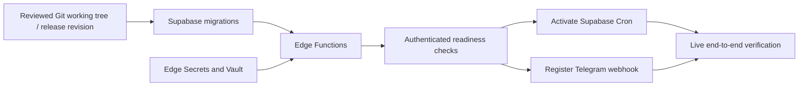

# Deployment model

## Current state and target

Phase 01 made no deployment or remote inspection. Phase 02 applied database migrations only to the operator's new isolated development project. No production schema deployment, bot, webhook or Cron job has been created. The target remains a real production deployment in Phase 10.

Phase 02 has verified migrations, restrictive grants, 70 hosted SQL assertions, ten query-plan checks, concurrent-client tests, cleanup and actual generated types. See [database workflow](docs/DATABASE_WORKFLOW.md) and [verification evidence](docs/verification/phase02-database.md). The test target has zero backups/PITR disabled; billing-plan visibility is limited by the scoped token. Production plan, pausing and recovery suitability remain release gates. The parent Git-scope issue from Phase 01 is resolved at the Phase 02 baseline.

No Railway server, VPS, container service, persistent local backend or additional queue service is needed. Local editing and deterministic tests use the repository. Database verification uses an isolated hosted target; the production database is persistent across Edge Function redeployments.

## Environments and phase gates

| Environment | Purpose | Restrictions |
| --- | --- | --- |
| Local repository | Authoring, pure Deno tests, sanitized fixture replay, documentation checks. | No mandatory local Supabase/Postgres/Docker. Secrets ignored; normal tests have no external network. |
| Isolated hosted test database/project/branch | Migrations, SQL constraints, RPCs, concurrency, grants and failure drills starting in 02. | Must be explicitly identified as disposable/test-only, with no production data. Migrations and tests cannot default to production. |
| Optional test function/bot target | Edge packaging/auth/runtime measurements and controlled transport checks after the owning implementation phase. | Separate secrets/bot identity and explicit task authorization. Never overwrite the production webhook for a test. |
| Existing production Supabase project | Real opportunities, profile, bot and schedules. | Only Phase 10 production activation; inventory/read-only planning may happen earlier. |

Each remote-writing script must require an explicit target project reference and environment classification, verify its identity against configuration, print a redacted summary, and fail closed on ambiguity. Never infer production from a linked CLI default. Tooling can use Supabase CLI or a scoped SQL connection as appropriate, but must not introduce a required local runtime.

## Future deployment inventory

- Database: private `radar` tables, reviewed backend-only RPCs, constraints/indexes, RLS, minimal grants, migration history, Cron/Vault/`pg_net` if supported and approved.
- Functions: `telegram-webhook`, `job-dispatch`, `job-worker`. `_shared` modules bundle with these; they are not independent public functions.
- Secrets: `TELEGRAM_BOT_TOKEN`, `TELEGRAM_WEBHOOK_SECRET`, `TELEGRAM_ALLOWED_USER_IDS`, `RADAR_INTERNAL_JOB_SECRET`; optional approved source credentials only when necessary. Backend Supabase keys are read through the platform's supported server secret configuration, verified on the actual project. Never create fake values in committed config.
- Vault: project URL and internal invocation secret needed by Cron. Edge Secret storage is not directly visible to SQL/Cron. Use Vault for that copy with documented rotation; do not paste secrets into migration SQL or stored schedule definitions.
- Configuration: actual profile and private-chat binding, approved source manifests/rows, logical cadence and delivery settings, pause flags, retention and quotas. Personal profile exports are not committed.
- Telegram: one bot, configured allowed private user/chat, restricted update types, HTTPS webhook URL and separate secret token.

The internal job secret has no direct database privileges. Edge functions authenticate it before constructing privileged use cases. Backend secret/service-role keys can bypass RLS and must never be used as source credentials or sent to Telegram. Current Supabase key formats and gateway checks must be verified using the project's supported mode; custom job/webhook authentication must not be accidentally blocked or treated as authenticated by `verify_jwt` alone. See the official [function authentication reference](https://supabase.com/docs/guides/functions/auth-headers).

Set `verify_jwt=false` for the three custom-auth functions and verify deployed settings: webhook requires the Telegram secret header; dispatcher/worker require `X-Radar-Job-Secret`. A function with missing secret configuration must deny requests, never fall back to public access. Cron sends only the custom job header from Vault, not a Supabase privileged database key.

## Release sequence for Phase 10

1. Confirm Phase 01-09 exit criteria, clean intended diff, target identity, source rights/coverage, supplied profile, bot credentials and explicit production activation. Do not create a GitHub repository or CI integration unless separately requested.
2. Read-only inventory the existing project and compare migration history. Check PostgreSQL/extensions, exposed schemas, auth/key mode, limits, cron availability, network constraints, quota/cost budget, and unrelated application objects. Any collision requires a reviewed plan.
3. Select a plan/settings combination compatible with unattended operation. Confirm current pause behavior, Edge CPU/memory/wall-time limits, invocation budget, log retention, backup coverage and restore options. No assumption that a free plan meets reliability requirements. Review [Edge limits](https://supabase.com/docs/guides/functions/limits) and [backup capabilities](https://supabase.com/docs/guides/platform/backups) against the actual account.
4. Establish a recovery point for existing data and verify restoration into an isolated target. Initial objectives: opportunity/feedback recovery point <=24 hours and recovery within 4 hours under an operator's control. If current plan/process cannot meet these objectives, resolve it before go-live. Do not restore over live data as a test.
5. Generate a migration plan and inspect SQL for secret values, unintended objects, grants, destructive operations and data rewrites. Apply approved additive migrations before compatible code. Production migrations are append-only; a release rollback normally reverts function code and pauses work, not drops tables.
6. Install/verify Edge Secrets and Vault entries through secure operator tooling. Never print secret values or credential-bearing CLI URLs; never place them in task evidence. Probe presence/auth behavior, not values.
7. Deploy versioned functions while delivery and scheduled collection remain paused. Verify packaging, authenticated/internal endpoint behavior, database RPC access, log redaction and anonymous denial. Check actual deployed config, not just local `config.toml`.
8. Configure profile, target binding and a small approved source scope. Run bounded live collection/ranking manually, inspect provenance, times/quality, deduplication and run accounting. Source-first tests must not send unsolicited notifications.
9. Register the real webhook with `setWebhook`, correct HTTPS URL, `secret_token`, only needed `allowed_updates`, and a conservative connection setting. Do not routinely drop pending updates. Inspect `getWebhookInfo`, send a real `/start`, test unauthorized/duplicate probes safely, and validate all user journeys.
10. Enable named Cron dispatch/worker jobs after authentication tests. Logical collection/ranking/digest/reminder/cleanup cadences remain separate in dispatch policy. Confirm `cron.job` definitions, run history, HTTP invocation results, and committed application outcomes.
11. Enable delivery, send a controlled real digest and reminder, confirm feedback/browsing/refresh/status, then observe seven days. Record daily evidence, partial failures, retry disposition, resource use and cost estimate. Keep Phase 10 active until the final Definition of Done passes.

All deployment commands/scripts are future Phase 10 artifacts. No setup command here implies they exist today. The future release verification task is `deno task release:verify`; it must report what it checked and refuse to call a deployment successful from an HTTP 2xx alone.

## Webhook lifecycle

Telegram webhook and polling are mutually exclusive. Production uses webhook only. Deploy handler/config/secrets before registering its URL. Use the [official Bot API lifecycle methods](https://core.telegram.org/bots/api#setwebhook) for `setWebhook`, `getWebhookInfo`, and `deleteWebhook`.

For a normal compatible redeployment, retain the webhook and database inbox. For a broken handler, pause outgoing sends and roll back function code; transient 5xx responses allow Telegram retry but its update retention is finite. Monitor backlog and recover promptly rather than assuming unlimited replay. Removing a webhook is an explicit maintenance action with a stated policy for pending updates. Never set `drop_pending_updates=true` by default.

Webhook-secret rotation: deploy support for old and new secret temporarily, update Telegram's configured secret, verify new requests, then remove the old value. Bot-token rotation changes send/API credentials; verify the actual bot identity and reset webhook configuration if required by the platform. Internal-job-secret rotation similarly overlaps Edge acceptance and Vault sender changes before removing the old credential. Never log both values to prove rotation.

## Rollback, backups and release evidence

Maintain a compatible previous function bundle/revision, migration list, settings version, webhook configuration summary and secret-presence checklist. On failure, pause dispatch/delivery, retain inbox/outbox/identity keys, revert code to a compatible revision, and inspect leased/sending work before replay. Forward-fix schema defects; destructive rollback and restore require a concrete recovery plan and authorization.

Store backups and sensitive exports outside Git with appropriate access controls. Verify actual restore coverage, including private schema, data, grants, functions and operational deduplication tables. Restore can rewind notification keys after Telegram already received messages; quarantine delivery after a restore and reconcile sent evidence before resuming. Database restoration is not a reset of external side effects.

Phase 10 records release date/revision, non-secret target identifier, migration/function versions, auth probes, approved source coverage, measured limits, live message evidence, Cron evidence, backup/restore drill, known limitations, daily observation results and final acceptance. Create `docs/releases/<date>-production-verification.md` at that time; no fictitious release record is created now.
