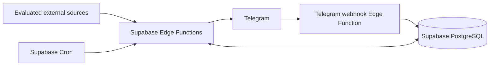

# Research Radar

Research Radar is a planned personal research opportunity intelligence system for one researcher. It will collect opportunities from a small, evaluated set of sources, normalize and deduplicate them, match them to a research profile, and deliver useful results through Telegram.

The intended coverage includes research jobs and internships, conferences and workshops, conference and journal calls for papers, special issues, grants, and other research funding. The final outcome is a deployed bot with automatic collection, daily digests, deadline reminders, and operational evidence that it works.

## Current status

Phases 01 and 02 are complete. Three database migrations, private persistence primitives and generated TypeScript types have passed isolated hosted SQL, concurrency, privilege, query-plan and cleanup checks. No phase is active; Phase 03 awaits explicit activation. No source collector, Telegram handler, configured schedule or production deployment exists. See [PLANS.md](PLANS.md), [verification evidence](docs/verification/phase02-database.md) and [database workflow](docs/DATABASE_WORKFLOW.md).

The Phase 02 Git baseline is correctly scoped to `D:/projects/research-bot`, branch `main`, commit `7c9b40c`. Phase 01's drive-level Git finding is historical. No repository initialization, parent metadata change, commit or push is part of Phase 02.

## Intended architecture



TypeScript and Deno-compatible libraries run in Supabase Edge Functions. Supabase PostgreSQL owns durable data, work leases, deduplication, feedback, and notification state. Supabase Cron initiates bounded jobs. `supabase-js` is the database client; narrow transactional database RPCs handle concurrent state changes. Telegram is an adapter around application use cases. The domain knows neither Telegram nor individual sources.

Filtering is deterministic. An optional future LLM can reorder an already filtered shortlist; the system must work with that feature disabled. No separate server, persistent local backend, mandatory local database, Docker runtime, or Python stack is required.

## Repository guide

| Path | Purpose |
| --- | --- |
| [PRODUCT_SPEC.md](PRODUCT_SPEC.md) | User journeys, requirements, final product acceptance |
| [ARCHITECTURE.md](ARCHITECTURE.md) | Boundaries, flows, reliability, security, ranking |
| [DATABASE.md](DATABASE.md) | Conceptual relational schema and transaction contracts |
| [DATA_SOURCES.md](DATA_SOURCES.md) | Evidence, source evaluation, priorities, onboarding |
| [DEPLOYMENT.md](DEPLOYMENT.md) | Future remote deployment and release gates |
| [OPERATIONS.md](OPERATIONS.md) | Future monitoring and recovery runbooks |
| [AGENTS.md](AGENTS.md) | Persistent engineering rules for future sessions |
| [PLANS.md](PLANS.md) | Execution source of truth and phase activation |
| [docs/adr/](docs/adr/) | Accepted decisions and ADR template |
| [docs/TESTING.md](docs/TESTING.md) | Validation contract and future testing approach |
| [docs/DATABASE_WORKFLOW.md](docs/DATABASE_WORKFLOW.md) | Pinned tools, isolation guards, migration verification and actual type generation |
| [harness/build/](harness/build/) | Ten bounded implementation specifications |
| [scripts/validate-docs.ps1](scripts/validate-docs.ps1) | Offline documentation consistency check |
| [CHANGELOG.md](CHANGELOG.md) | Completed project changes |

The future application layout is specified in ARCHITECTURE.md. Database files now live under `supabase/migrations/` and `supabase/tests/database/`; operator tooling lives in `scripts/db/`. Application modules are added by their owning phases.

## Development process

Read AGENTS.md, PLANS.md, and the active phase specification before changing files. Inspect what exists, implement only that phase, run its validation, update its evidence and roadmap entry, then stop. Completing a phase never automatically authorizes the next phase. Architecture changes require an ADR and corresponding documentation updates.

Repository-side checks are available as `deno task check` using pinned tooling. The independent documentation check remains:

```powershell
powershell -NoProfile -ExecutionPolicy Bypass -File scripts/validate-docs.ps1
```

Use the host's RTK prefix where available. Copy [.env.example](.env.example) to ignored `.env` and fill credentials locally; database tasks load that file automatically. `deno task db:plan` and `deno task db:verify` fail closed until an isolated target and secure environment configuration exist. Pinned npm-cache bootstrap instructions are in the database workflow. Application/source and production deployment tasks remain later-phase work.
