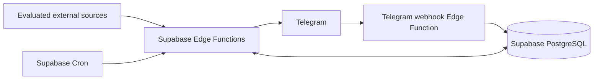

# Research Radar

Research Radar is a planned personal research opportunity intelligence system for one researcher. It will collect opportunities from a small, evaluated set of sources, normalize and deduplicate them, match them to a research profile, and deliver useful results through Telegram.

The intended coverage includes research jobs and internships, conferences and workshops, conference and journal calls for papers, special issues, grants, and other research funding. The final outcome is a deployed bot with automatic collection, daily digests, deadline reminders, and operational evidence that it works.

## Current status

This repository contains the Phase 01 specification and engineering contract. There is no application runtime, database migration, source collector, Telegram handler, configured schedule, or deployment yet. The existing remote Supabase project has not been inspected or modified. See [PLANS.md](PLANS.md) for authoritative phase status.

The project directory was empty at inspection. Git resolved to `D:/`, outside this directory; no repository was initialized and no Git configuration was changed. Before staging project work in a future session, verify that Git is intentionally scoped to this project. No commit or push is part of this phase.

## Intended architecture



TypeScript and Deno-compatible libraries run in Supabase Edge Functions. Supabase PostgreSQL owns durable data, work leases, deduplication, feedback, and notification state. Supabase Cron initiates bounded jobs. `supabase-js` is the database client; narrow transactional database RPCs handle concurrent state changes. Telegram is an adapter around application use cases. The domain knows neither Telegram nor individual sources.

Filtering is deterministic. An optional future LLM can reorder an already filtered shortlist; the system must work with that feature disabled. No separate server, persistent local backend, mandatory local database, Docker runtime, or Python stack is required.

## Repository guide

| Path | Purpose |
| --- | --- |
| [PRODUCT_SPEC.md](PRODUCT_SPEC.md) | User journeys, requirements, final product acceptance |
| [ARCHITECTURE.md](ARCHITECTURE.md) | Boundaries, flows, reliability, security, ranking |
| [DATABASE.md](DATABASE.md) | Conceptual relational schema and transaction contracts |
| [DATA_SOURCES.md](DATA_SOURCES.md) | Evidence, source evaluation, priorities, onboarding |
| [DEPLOYMENT.md](DEPLOYMENT.md) | Future remote deployment and release gates |
| [OPERATIONS.md](OPERATIONS.md) | Future monitoring and recovery runbooks |
| [AGENTS.md](AGENTS.md) | Persistent engineering rules for future sessions |
| [PLANS.md](PLANS.md) | Execution source of truth and phase activation |
| [docs/adr/](docs/adr/) | Accepted decisions and ADR template |
| [docs/TESTING.md](docs/TESTING.md) | Validation contract and future testing approach |
| [harness/build/](harness/build/) | Ten bounded implementation specifications |
| [scripts/validate-docs.ps1](scripts/validate-docs.ps1) | Offline documentation consistency check |
| [CHANGELOG.md](CHANGELOG.md) | Completed project changes |

The future module layout is specified in ARCHITECTURE.md. Empty application directories and fake setup commands have deliberately not been added.

## Development process

Read AGENTS.md, PLANS.md, and the active phase specification before changing files. Inspect what exists, implement only that phase, run its validation, update its evidence and roadmap entry, then stop. Completing a phase never automatically authorizes the next phase. Architecture changes require an ADR and corresponding documentation updates.

The only executable validation currently provided is the documentation check, from the repository root:

```powershell
powershell -NoProfile -ExecutionPolicy Bypass -File scripts/validate-docs.ps1
```

Use the host's RTK command prefix where available, as described in AGENTS.md. Deno tasks, database validation, source fixtures, and deployment scripts will be created in their owning phases; they are not available today.
