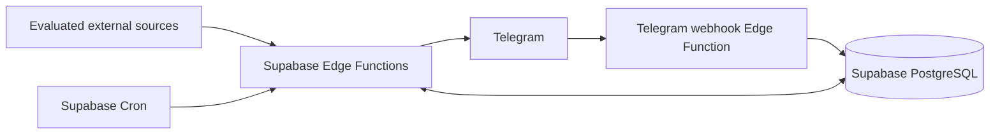

# Research Radar

Research Radar is a planned personal research opportunity intelligence system for one researcher. It will collect opportunities from a small, evaluated set of sources, normalize and deduplicate them, match them to a research profile, and deliver useful results through Telegram.

The intended coverage includes research jobs and internships, conferences and workshops, conference and journal calls for papers, special issues, grants, and other research funding. The final outcome is a deployed bot with automatic collection, daily digests, deadline reminders, and operational evidence that it works.

## Current status

Phases 01-07 are complete; Phase 08 is active and Phase 09 remains pending. The existing deterministic scorer now has strict profile editing, versioned reasons/time validity and bounded persisted-data reranking. Offline validation passes 116 unit/38 contract tests; hosted SQL passes 172 assertions/ten plans. Actual researcher preferences and human threshold calibration remain open, so Phase 08 cannot be marked complete. No function, bot, webhook, schedule or production deployment is active. See [PLANS.md](PLANS.md), [Phase 08 evidence](docs/verification/phase08-ranking.md), [profile guide](docs/RANKING.md), [Telegram runbook](docs/TELEGRAM.md) and [database workflow](docs/DATABASE_WORKFLOW.md).

The repository is scoped to `D:/projects/research-bot`, branch/default branch `main`. Phase 07 was committed/pushed as `96eb828` before Phase 08 entered with a clean worktree. This task does not commit, push or deploy. Phase 01's drive-level Git finding is historical.

This product uses the Grants.gov API but is not endorsed or certified by the U.S. Department of Health and Human Services.

## Intended architecture



TypeScript and Deno-compatible libraries run in Supabase Edge Functions. Supabase PostgreSQL owns durable data, work leases, deduplication, feedback, and notification state. Supabase Cron initiates bounded jobs. `supabase-js` is the database client; narrow transactional database RPCs handle concurrent state changes. Telegram is an adapter around application use cases. The domain knows neither Telegram nor individual sources.

Filtering is deterministic. An optional future LLM can reorder an already filtered shortlist; the system must work with that feature disabled. No separate server, persistent local backend, mandatory local database, Docker runtime, or Python stack is required.

## Repository guide

| Path | Purpose |
| --- | --- |
| [PRODUCT_SPEC.md](PRODUCT_SPEC.md) | User journeys, requirements, final product acceptance |
| [ARCHITECTURE.md](ARCHITECTURE.md) | Boundaries, flows, reliability, security, ranking |
| [DATABASE.md](DATABASE.md) | Conceptual relational schema and transaction contracts |
| [DATA_SOURCES.md](DATA_SOURCES.md) | Evidence, source evaluation, priorities, onboarding |
| [DEPLOYMENT.md](DEPLOYMENT.md) | Future remote deployment and release gates |
| [OPERATIONS.md](OPERATIONS.md) | Future monitoring and recovery runbooks |
| [AGENTS.md](AGENTS.md) | Persistent engineering rules for future sessions |
| [PLANS.md](PLANS.md) | Execution source of truth and phase activation |
| [docs/adr/](docs/adr/) | Accepted decisions and ADR template |
| [docs/TESTING.md](docs/TESTING.md) | Validation contract and future testing approach |
| [docs/DATABASE_WORKFLOW.md](docs/DATABASE_WORKFLOW.md) | Pinned tools, isolation guards, migration verification and actual type generation |
| [harness/build/](harness/build/) | Ten bounded implementation specifications |
| [scripts/validate-docs.ps1](scripts/validate-docs.ps1) | Offline documentation consistency check |
| [CHANGELOG.md](CHANGELOG.md) | Completed project changes |

Application modules live in `supabase/functions/_shared/{domain,application,adapters,infrastructure}/`, with `job-worker/index.ts` as a thin composition root. Offline fixtures/tests live under `tests/`; database assertions live under `supabase/tests/database/`; migrations/operator tooling live in `supabase/migrations/` and `scripts/db/`.

## Development process

Read AGENTS.md, PLANS.md, and the active phase specification before changing files. Inspect what exists, implement only that phase, run its validation, update its evidence and roadmap entry, then stop. Completing a phase never automatically authorizes the next phase. Architecture changes require an ADR and corresponding documentation updates.

Repository-side checks are available as `deno task check` using pinned tooling. The independent documentation check remains:

```powershell
powershell -NoProfile -ExecutionPolicy Bypass -File scripts/validate-docs.ps1
```

Use the host's RTK prefix where available. `deno task test:unit` and `deno task test:contract` run without network or credential access. Copy [.env.example](.env.example) to ignored `.env` and fill operator credentials locally for hosted tasks. `db:plan`, `db:verify` and `test:integration` fail closed without an explicitly verified isolated hosted target. Pinned bootstrap/type-regeneration instructions are in the database workflow. No deployment is needed to verify the core.
